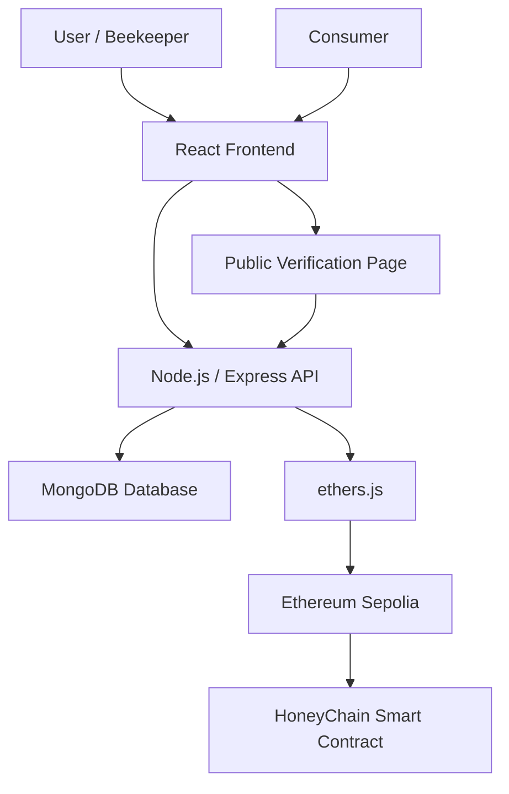

# 🍯 HoneyChain – Blockchain-Based Honey Traceability & Smart Beekeeping

**HoneyChain** is a full-stack blockchain-powered honey traceability platform designed to improve transparency in honey production and smart beekeeping.

The platform enables beekeepers to manage their hives, register honey harvest batches, track processing stages and generate QR codes for public product verification.

By integrating Ethereum blockchain technology, HoneyChain provides a mechanism to verify the integrity of recorded honey batch information.

<p align="center">
  <a href="https://honeychainapito.netlify.app">Live Application</a> •
  <a href="https://github.com/omsingh-blip/HoneyChain">GitHub Repository</a> •
  <a href="https://honeychain-kram.onrender.com">Backend API</a>
</p>

---

## 🚀 Live Demo

| Component | Link |
|---|---|
| Frontend Application | https://honeychainapito.netlify.app |
| Backend API | https://honeychain-kram.onrender.com |
| API Base URL | https://honeychain-kram.onrender.com/api |
| Smart Contract | [View on Sepolia Etherscan](https://sepolia.etherscan.io/address/0xCFA2B16D146C17d26D76269A6d98dF52Ea539045) |

---

## ✨ Features

### 1. Authentication & Authorization
- User registration and login.
- JWT-based authentication.
- Password hashing using bcrypt.
- Protected application routes.
- Authenticated API endpoints.

### 2. Smart Hive Management
- Register and manage beehives.
- Store hive identification and location details.
- Record bee species and hive health status.
- Track inspection dates.
- Search and filter hives.
- Edit and deactivate hive records.

### 3. Honey Batch Management
- Register honey harvest batches.
- Associate each batch with its source hive.
- Record honey type, quantity and harvest date.
- Track apiary location and harvest observations.
- Search and filter honey batches.
- Monitor batch processing stages.

### 4. Blockchain Integration
- Record honey batch metadata hashes on Ethereum Sepolia.
- Store transaction and smart contract details.
- Verify batch hashes against on-chain records.
- Retry blockchain recording when an initial attempt fails.
- Maintain a blockchain-backed record of batch metadata integrity.

### 5. QR Code-Based Traceability
- Generate unique QR codes for honey batches.
- Download QR code images.
- Print honey labels with batch information.
- Allow consumers to access public batch verification without logging in.

### 6. Public Verification
- Verify honey batches using their Batch ID.
- Access traceability information through QR codes.
- View source hive and harvest details.
- Inspect batch status history.
- Compare database and blockchain hashes.
- View blockchain transaction information.

### 7. Analytics Dashboard
- Active hive statistics.
- Total honey harvested.
- Hives requiring inspection.
- Packaged batch statistics.
- Six-month honey harvest chart.
- Hive health overview.
- Recent honey batch activity.

---

## 🛠️ Technology Stack

| Category | Technologies |
|---|---|
| Frontend | React, Vite, JavaScript |
| Styling | Tailwind CSS v4 |
| State Management | Zustand |
| Data Visualization | Recharts |
| HTTP Requests | Axios |
| Backend | Node.js, Express.js |
| Database | MongoDB, Mongoose |
| Authentication | JWT, bcrypt |
| Blockchain | Ethereum, Solidity |
| Smart Contract Framework | Hardhat 2 |
| Blockchain Interaction | ethers.js |
| Network | Ethereum Sepolia |
| Deployment | Netlify, Render |
| Version Control | Git, GitHub |

---

## 🏗️ System Architecture

HoneyChain follows a modular architecture consisting of a frontend application, backend API, database and blockchain network.



### How It Works

1. A beekeeper registers an account and adds beehive information.
2. A honey harvest is registered as a batch and associated with its source hive.
3. Batch information is stored in MongoDB.
4. The backend generates a hash of the batch metadata and attempts to record it on the Ethereum blockchain.
5. The blockchain transaction provides an immutable reference for subsequent hash verification.
6. A QR code is generated for the batch.
7. Consumers scan the QR code to access the public verification page.
8. The application compares the batch metadata hash with the database and blockchain records.

**Important:** Blockchain verification establishes the integrity of recorded metadata. It does not independently certify honey purity, quality or physical origin.

---

## 📂 Project Structure

```text
HoneyChain/
│
├── client/
│   ├── public/
│   ├── src/
│   │   ├── assets/
│   │   ├── components/
│   │   │   ├── auth/
│   │   │   ├── common/
│   │   │   ├── layout/
│   │   │   └── sections/
│   │   ├── pages/
│   │   ├── services/
│   │   ├── store/
│   │   ├── App.jsx
│   │   └── main.jsx
│   └── package.json
│
├── server/
│   ├── src/
│   │   ├── config/
│   │   ├── controllers/
│   │   ├── middleware/
│   │   ├── models/
│   │   ├── routes/
│   │   ├── services/
│   │   └── server.js
│   ├── .env.example
│   └── package.json
│
├── blockchain/
│   ├── contracts/
│   │   └── HoneyChain.sol
│   ├── scripts/
│   │   ├── deploy.cjs
│   │   └── test-contract.cjs
│   ├── hardhat.config.cjs
│   └── package.json
│
├── docs/
│   ├── architecture.md
│   ├── installation.md
│   ├── api-documentation.md
│   ├── smart-contract.md
│   ├── user-guide.md
│   └── deployment.md
│
├── netlify.toml
└── .gitignore
```

---

## ⚙️ Installation & Setup

### Prerequisites

Make sure the following tools are installed:

- Node.js
- npm
- Git
- MongoDB or MongoDB Atlas account
- Ethereum Sepolia RPC provider
- Ethereum wallet for smart contract deployment

### 1. Clone the Repository

```bash
git clone https://github.com/omsingh-blip/HoneyChain.git

cd HoneyChain
```

### 2. Install Frontend Dependencies

```bash
cd client
npm install
```

### 3. Install Backend Dependencies

```bash
cd ../server
npm install
```

### 4. Configure Backend Environment Variables

Create a `.env` file inside the `server` directory.

```env
PORT=5000
CLIENT_URL=http://localhost:5173
MONGODB_URI=your_mongodb_connection_string
JWT_SECRET=your_secure_jwt_secret
JWT_EXPIRES_IN=1d
```

Replace the placeholder values with your own configuration.

### 5. Configure Frontend API URL

Configure the frontend API base URL to point to your local backend:

```text
http://localhost:5000/api
```

Use the environment variable name expected by the frontend service configuration.

### 6. Start the Backend

```bash
cd server
npm run dev
```

### 7. Start the Frontend

Open another terminal:

```bash
cd client
npm run dev
```

The Vite development server will display the local frontend URL, normally:

```text
http://localhost:5173
```

---

## ⛓️ Blockchain Setup

### 1. Install Dependencies

```bash
cd blockchain
npm install
```

### 2. Configure Environment Variables

Create a `.env` file inside the `blockchain` directory.

```env
SEPOLIA_RPC_URL=your_sepolia_rpc_url
SEPOLIA_PRIVATE_KEY=your_wallet_private_key
```

Never commit this file or expose your wallet's private key.

### 3. Compile the Smart Contract

```bash
npx hardhat compile
```

### 4. Deploy to Sepolia

After configuring a valid RPC endpoint and a funded Sepolia deployment wallet:

```bash
npx hardhat run scripts/deploy.cjs --network sepolia
```

Save the resulting contract address and configure the backend to use the deployed contract.

For additional instructions, see [Smart Contract Documentation](docs/smart-contract.md).

---

## 📡 API Overview

The backend exposes REST API endpoints for authentication, hive management and honey batch operations.

| Method | Endpoint | Description |
|---|---|---|
| POST | `/api/auth/register` | Register a user |
| POST | `/api/auth/login` | Authenticate a user |
| GET | `/api/auth/me` | Get authenticated user |
| POST | `/api/hives` | Create a hive |
| GET | `/api/hives` | Retrieve hives |
| GET | `/api/hives/:id` | Retrieve a specific hive |
| PATCH | `/api/hives/:id` | Update hive information |
| DELETE | `/api/hives/:id` | Deactivate a hive |
| POST | `/api/batches` | Create a honey batch |
| GET | `/api/batches` | Retrieve batches |
| GET | `/api/batches/:id` | Retrieve a specific batch |
| PATCH | `/api/batches/:id` | Update batch information |
| PATCH | `/api/batches/:id/status` | Update batch status |
| GET | `/api/batches/trace/:batchId` | Public batch traceability |
| POST | `/api/batches/:id/blockchain/retry` | Retry blockchain recording |

Protected endpoints require a JWT Bearer token.

For complete request and response details, see [API Documentation](docs/api-documentation.md).

---

## 🔐 Smart Contract

The HoneyChain smart contract is written in Solidity `0.8.28`.

Its main responsibilities include:

- Recording batch identifiers.
- Storing metadata hashes.
- Recording blockchain timestamps.
- Identifying the address that recorded a batch.
- Verifying submitted metadata hashes.
- Providing access to recorded batch information.
- Restricting batch recording to the contract owner.

### Main Contract Functions

| Function | Purpose |
|---|---|
| `recordBatch()` | Records a batch hash on-chain |
| `verifyBatch()` | Verifies a submitted hash |
| `getBatch()` | Retrieves recorded batch information |
| `transferOwnership()` | Transfers contract ownership |

**Deployed Network:** Ethereum Sepolia

**Contract Address:** `0xCFA2B16D146C17d26D76269A6d98dF52Ea539045`

[View Smart Contract on Etherscan](https://sepolia.etherscan.io/address/0xCFA2B16D146C17d26D76269A6d98dF52Ea539045)

---

## 📚 Documentation

Detailed project documentation is available in the `docs/` directory.

| Document | Description |
|---|---|
| [Architecture](docs/architecture.md) | System architecture and component design |
| [Installation](docs/installation.md) | Local development setup |
| [API Documentation](docs/api-documentation.md) | Backend endpoints and API usage |
| [Smart Contract](docs/smart-contract.md) | Contract functions and blockchain integration |
| [User Guide](docs/user-guide.md) | Application usage instructions |
| [Deployment](docs/deployment.md) | Frontend, backend and blockchain deployment |

---

## 🔮 Future Improvements

- IoT sensor integration for real-time hive monitoring.
- Temperature and humidity tracking.
- Environmental monitoring and alerts.
- Advanced beekeeping analytics.
- More detailed production and supply-chain tracking.
- Consumer-facing product information and verification improvements.
- Integration with additional blockchain networks.

---

## 👨‍💻 Author

**Om Singh**

B.Tech Student | Full-Stack Developer

- GitHub: [omsingh-blip](https://github.com/omsingh-blip)
- LinkedIn: [Om Singh](https://www.linkedin.com/in/om-singh-610a69342/)

---

## 📄 License

This project currently does not specify a license. All rights are reserved by the project author unless a license is added to the repository.

---

<p align="center">
  Built with 🍯 and blockchain technology.
  <br/>
  <strong>HoneyChain – Making Honey Traceability More Transparent.</strong>
</p>
